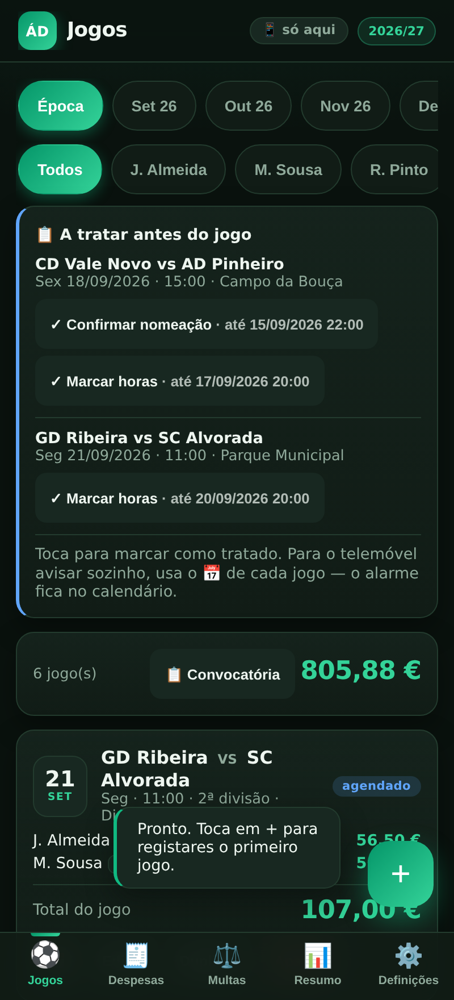
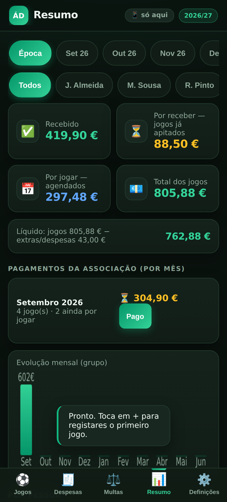
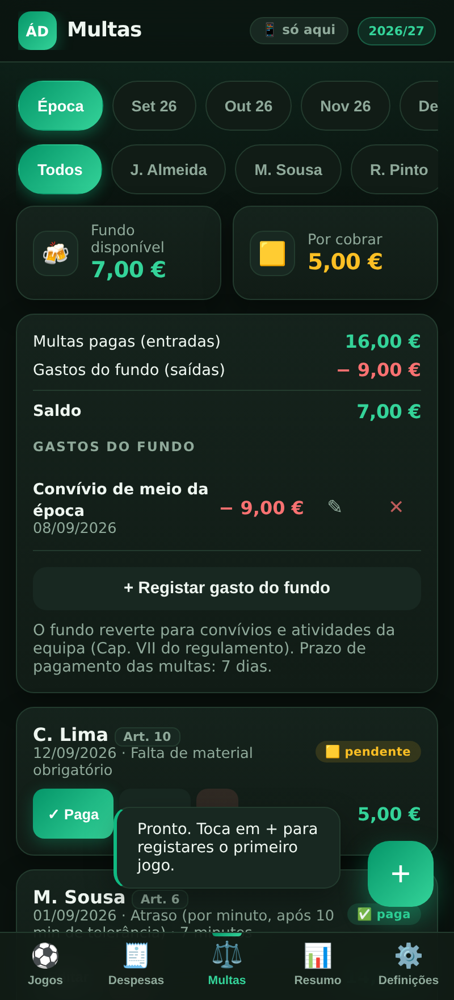

# Arbitragem — Ganhos & Despesas

App web (PWA) para gerir jogos, ganhos, despesas e multas de uma equipa de arbitragem de futebol.
Substituiu a folha de Excel onde eu registava as nomeações: instala-se no telemóvel, cada árbitro
tem a sua conta, a equipa partilha os dados através do Supabase, e continua a funcionar num campo
sem rede.

<p align="center">
  
  
  
</p>

> As capturas usam dados inventados — o repositório é público e os nomes e valores reais da equipa
> não têm de andar cá fora. São geradas por `npm run capturas`.

## Porquê

Um árbitro assistente faz uma dezena de jogos por mês entre distritais e nacionais, cada um com a
sua tarifa, almoço e deslocação, e a associação paga tudo junto ao fim do mês. O Excel dava para
somar, mas não dava para registar no telemóvel à saída do balneário, nem para avisar de um prazo do
regulamento, nem para a equipa ver o mesmo que eu.

**Em uso:** desde setembro de 2026, por duas equipas de arbitragem (árbitros e assistentes de
competições distritais e nacionais), com os jogos, pagamentos e despesas reais da época.

## Stack

- **Frontend:** HTML/CSS/JavaScript sem build nem dependências. `index.html` (estrutura e estilos),
  `js/*.js` (a app, por áreas), `engine.js` (funções puras: cálculo, parser, calendário) e
  `dados.js` (tradução entre as tabelas e os ecrãs) — todos scripts clássicos.
- **Dados:** **Supabase** (PostgreSQL + Auth + RLS). Cada pessoa tem conta própria; a equipa tem um
  responsável (escreve) e assistentes (veem os seus valores e as multas da equipa; lançam as suas
  despesas). As permissões vivem na base de dados, não nos botões.
- **Sem rede:** service worker (`sw.js`) com a app em cache, uma cópia dos dados da última vez que
  houve rede e uma fila das alterações feitas offline, enviadas por ordem quando a rede volta
  (`js/offline.js`).
- **Avisos:** notificações push dos prazos do regulamento, decididas e enviadas por uma Edge Function
  (`supabase/functions/avisos-prazos`) de 10 em 10 minutos.
- **Testes:** motor e regras dos avisos em Node; nove suítes end-to-end em Playwright contra um
  Supabase de mentira; provas das políticas RLS em SQL.

## O que faz

- Registo de jogos com várias pessoas, função, almoço e deslocação, e cálculo automático pela tabela
  de valores da associação; várias épocas, cada uma com as suas tarifas
- **Colar convocatória** — ou **partilhá-la** diretamente do WhatsApp/SMS para a app: extrai data,
  hora, escalão, equipas, campo e funções, e reconhece os colegas por inicial e apelido
- **Jogo de hoje**: hora, quanto falta para o apito, botões para o Maps/Waze e a lista do que não
  pode ficar esquecido, tirada do regulamento
- **Prazos do regulamento** (Art. 3 e 4) na lista "A tratar", em **avisos push** e no **calendário
  (.ics)** com alarmes
- **Km memorizados por campo**, **multas e fundo da equipa**, **pagamentos mensais da associação**
  com a diferença entre o calculado e o recebido
- Resumo por mês, pessoa e escalão; **ano civil** (para o IRS) com CSV; relatório da época imprimível
- Entrada na equipa por **código de convite com aprovação** do responsável; **Apagados** repõe o que
  foi apagado nos últimos 30 dias

## Correr localmente

```bash
npm install && npx playwright install chromium
npm run servir     # http://localhost:8099
npm test           # tudo: motor, avisos e as suítes end-to-end
npm run capturas   # regenera as imagens deste README
```

Sem Supabase configurado, a app abre no ecrã de conta e pede o URL e a chave do projeto.

## Ficheiros

| Ficheiro | Descrição |
|---|---|
| `index.html` | Estrutura, estilos e a ordem de carregamento dos scripts |
| `js/` | A app por áreas: `base`, `calculo`, `jogos`, `despesas-multas`, `resumo`, `bd`, `offline`, `conta`, `sessao`, `definicoes`, `avisos`, `arranque` |
| `engine.js` | Motor: funções puras, testáveis em Node sem browser |
| `dados.js` | Tradução entre as tabelas da base de dados e os ecrãs |
| `sw.js` | Service worker — cache offline, partilhas, avisos push e aviso de nova versão |
| `manifest.webmanifest` | Manifesto PWA, com partilha para a app e atalhos no ícone |
| `sql/` | Esquema, permissões, migração e provas, por ordem (ver abaixo) |
| `supabase/functions/avisos-prazos/` | Edge Function dos avisos push (`regras.js` é testado em Node) |
| `config.example.js` | Modelo das credenciais — copiar para `config.local.js` |
| `docs/AVISOS-PUSH.md` | Como ligar os avisos push |
| `tests/` | Suítes, Supabase de mentira e servidor estático |
| `LEIA-ME.md` | Manual de utilização |

## Configuração do Supabase

1. Criar um projeto em [supabase.com](https://supabase.com).
2. **SQL Editor** → correr, por esta ordem:

   | Ficheiro | Para quê |
   |---|---|
   | `01-esquema.sql` | Tabelas, papéis e políticas RLS |
   | `02-provas.sql` | Provas das permissões — tem de acabar em "TUDO PASSOU" |
   | `03-migracao.sql` | **Só** para quem vem da versão antiga (tabela `estado`) |
   | `04-guardar-jogo.sql` | Gravar um jogo e as participações numa transação |
   | `05-seguranca-dados.sql` | Lixo de 30 dias, aprovação de membros, prazo e limite do código de convite |
   | `06-provas-fase2.sql` | Provas do 04 e do 05 |
   | `07-avisos-push.sql` e `08-agendamento-avisos.sql` | Avisos push (opcional — ver `docs/AVISOS-PUSH.md`) |

3. **Authentication → Sign In / Up:** o registo de contas tem de estar **ligado** — cada pessoa cria
   a sua na app. Quem pode entrar numa equipa é decidido pelo código de convite e pela aprovação
   do responsável, não pelo registo.
4. **Project Settings → API** → copiar o *Project URL* e a chave *anon public* para o
   `config.local.js` (a partir do `config.example.js`):

```js
window.SB_CONFIG = { url: "https://xxxx.supabase.co", key: "eyJ...", vapid: "" };
```

> `config.local.js` está no `.gitignore`: as credenciais nunca entram no repositório. A chave
> *anon* é pública por design; quem protege os dados é a RLS. O `vapid` é a chave **pública** dos
> avisos push e só é preciso se os ligares.

Manual de utilização em [`LEIA-ME.md`](LEIA-ME.md).

## Licença

[MIT](LICENSE).
